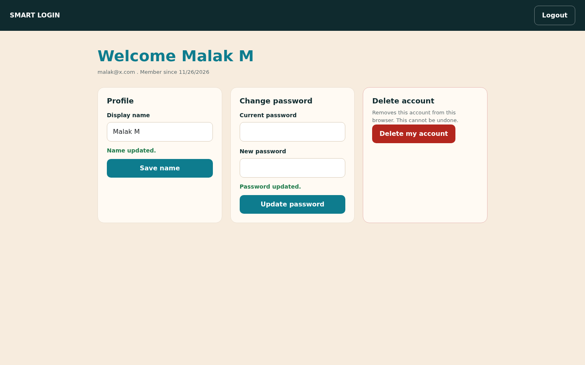

# Smart Login System

A client-side registration and login system built with vanilla JavaScript.
Users create an account, sign in, and land on a personal welcome page - with a
real logout that clears the session. All data lives in localStorage; there is
no backend, so it is a learning project, not production auth.

**Live demo:** https://malakmo7amed309.github.io/smart-login/

## Screenshots

| Login | Register | Welcome |
| --- | --- | --- |
|  |  |  |

## Features

- Sign up with name, email and password
- Validation: required fields, email format, minimum password length
- Duplicate-email detection (case-insensitive)
- Login with inline error messages, no disruptive alerts
- Protected welcome page: redirects to login when nobody is signed in
- Logout clears the session
- Passwords are salted and hashed (SHA-256, Web Crypto) before they are stored; accounts from v1 with plaintext passwords are upgraded on their next login
- Show/hide password, strength meter, remember my email
- Profile page: change display name, change password, delete account

Note: this is client-side only. A real app needs a server and a slow password hash such as bcrypt or argon2.

## Tech stack

- HTML5, CSS3
- Vanilla JavaScript (localStorage)
- Bootstrap 5 (grid and form base) with custom CSS and inline SVG icons

## Run locally

Open `index.html` in a browser. No build step.

## Author

Malak Mohamed - [GitHub](https://github.com/malakmo7amed309)
